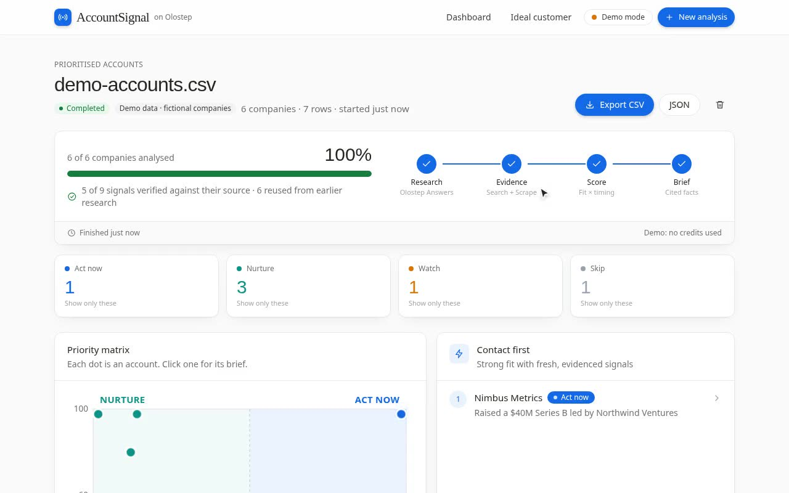

<div align="center">

# AccountSignal

**Know which accounts to contact first, and why now.**

Upload a list of companies. AccountSignal researches each one with live web data from
[Olostep](https://www.olostep.com), checks every buying signal against its source, and ranks your
accounts by **ICP fit** and **timing**, with a short, cited brief for each one.

[](https://github.com/asadjan4611/accountsignal/actions/workflows/ci.yml)
[](LICENSE)


[](https://www.olostep.com)

[](client/public/demo/accountsignal-demo.mp4)

▶ **[Watch the 100-second demo](client/public/demo/accountsignal-demo.mp4)** · voice-over and captions

[Quick start](#quick-start) · [How it works](#how-it-works) · [Scoring](#how-accounts-are-scored) ·
[Costs](#costs) · [Configuration](#configuration) · [API](#api-reference)

</div>

---

## Why AccountSignal

Lead enrichment tools fill in columns. Sales teams still have to decide **who to call this week**.

AccountSignal turns company research into that decision:

- **One prioritised list.** Every account lands in _Act now_, _Nurture_, _Watch_ or _Skip_.
- **Reasons you can check.** Every buying signal links to its source, and AccountSignal opens that
  page to confirm it actually says what was claimed.
- **No black box.** Scores come from plain, documented rules, not from a model's opinion.
- **Cost before commitment.** You see the credit cost before a single request is made.

> Olostep does the research. AccountSignal makes the GTM decision.

## Features

|                                |                                                                                                   |
| ------------------------------ | ------------------------------------------------------------------------------------------------- |
| 🎯 **Ideal customer profile**  | Industries, locations, company size, tech stack, funding stage, funding raised and hiring         |
| 📄 **Forgiving CSV import**    | Columns detected automatically, every row validated, duplicates grouped, personal emails flagged  |
| 🔎 **Live research**           | Profile, size, funding, technologies and dated buying signals for each company                    |
| ✅ **Evidence checks**         | Each signal's source page is opened and checked: _verified_, _partly supported_ or _unverified_   |
| 📊 **Priority matrix**         | Fit against timing at a glance, plus Board, Table and original-rows views with search and sorting |
| 📝 **Account briefs**          | Why it fits, why now, gaps and what to check next, built only from cited facts. One-click copy    |
| 💰 **Cost estimate & balance** | Credit and USD range before you run, checked against your live Olostep balance                    |
| ♻️ **Research cache**          | Re-running the same companies within 7 days reuses research and only re-checks evidence           |
| 📤 **Export**                  | CSV or JSON with scores, signals, evidence and sources                                            |
| 🧪 **Demo mode**               | A complete run on fictional companies, with no API key and no credits                             |

## Quick start

**Requirements:** Node.js 20.19 or newer. An [Olostep API key](https://www.olostep.com) is only
needed for real companies.

```bash
git clone https://github.com/asadjan4611/accountsignal.git
cd accountsignal
cp .env.example .env
```

Install and start with **npm**:

```bash
npm ci
npm run dev
```

Or with **pnpm**:

```bash
pnpm install --frozen-lockfile
pnpm dev
```

Open **http://localhost:5173** and click **Try the demo**. Six fictional companies run through the
full pipeline (evidence checks, scoring and briefs) in about ten seconds.

That's all. There is no database, no Docker and no other API key to set up.

### Analyse real companies

1. Add your key to `.env`:

   ```bash
   OLOSTEP_API_KEY=your_key_here
   ```

2. Restart the app. The dashboard checks the key and shows your credit balance (this check is free).
3. Click **New analysis**, define your ideal customer, and upload a CSV.

The bundled [`sample-data/accounts.csv`](sample-data/accounts.csv) (Vercel, Supabase, Linear,
PostHog, Resend) costs about **100–165 credits**.

### CSV format

Only one of `company_name` or `domain` is required per row. A domain gives the best results.

```csv
company_name,domain,contact_email
Acme,acme.com,john@acme.com
CloudTech,cloudtech.com,
```

Common column names (`company`, `organization`, `website`, `url`, `email`…) are detected
automatically, and you can change the mapping on the preview screen. Up to 1,000 rows and 5 MB per
file by default.

## How it works

| Step            | What happens                                                                                     |
| --------------- | ------------------------------------------------------------------------------------------------ |
| 1. **Define**   | Describe your ideal customer once. Every account is scored against it.                           |
| 2. **Upload**   | Rows are validated and grouped by company, so each company is researched only once.              |
| 3. **Research** | One Olostep Answers request returns a structured profile and dated buying signals, with sources. |
| 4. **Verify**   | Olostep Scrape opens each signal's source; Olostep Search finds one when a signal has none.      |
| 5. **Score**    | ICP fit and timing are calculated with the rules below and combined into a priority.             |
| 6. **Brief**    | A short brief is written from cited facts only: why it fits, why now, gaps, what to check next.  |
| 7. **Act**      | Work the list from _Act now_ down, open any account for its evidence, and export the results.    |

## How accounts are scored

### ICP fit (0–100)

Each criterion you set is **matched**, **missed** or **unknown** (no reliable data). Fit is the
share of criteria matched. Unknown never counts as a match.

### Timing (0–100)

Each buying signal earns points:

```text
points   = type weight × recency × evidence

type     funding 30 · hiring 25 · launch 20 · expansion 20 · leadership 15 · partnership 15 · other 10
recency  ≤30 days 1.0 · ≤90 0.7 · ≤180 0.4 · ≤365 0.2 · older 0 · undated 0.2
evidence verified 1.0 · partly supported 0.7 · unverified 0.4
```

Only the strongest signal of each type counts, so ten job posts can't outweigh real variety.
60 points is a timing score of 100 (for example, a fresh verified funding round plus fresh hiring).

### Priority

|              | Timing ≥ 50 | Timing < 50 |
| ------------ | ----------- | ----------- |
| **Fit ≥ 60** | **Act now** | Nurture     |
| **Fit < 60** | Watch       | Skip        |

### Evidence

A signal is **verified** when its source page loads, names the company, and contains most of the
claim's key words and figures. It is **partly supported** when only some of that holds, and
**unverified** when there is no source, the page doesn't load, or it doesn't support the claim.

Buying signals suggest an opportunity. They are never treated as proof that a company wants to buy.

## Costs

AccountSignal shows the exact credit range before every run. Scoring, briefs and the key check are
free.

| Olostep endpoint         | Used for                                           | Credits                         |
| ------------------------ | -------------------------------------------------- | ------------------------------- |
| `POST /v1/answers`       | Researching each company (one request per company) | 20 per company                  |
| `POST /v1/scrapes`       | Opening a signal's source page to check it         | 1 per page, max 3 per company   |
| `POST /v1/searches`      | Finding a source when a signal has none            | 5 per search, max 2 per company |
| `GET /user/credits/info` | Checking your key and balance                      | Free                            |

That is **20–33 credits per company**, and less when research is reused from the cache. Failed or
empty pages cost nothing. Evidence checks can be switched off before a run.

## Use Olostep in your own code

The core research call fits in one dependency-free file:
[`examples/research-one-company.mjs`](examples/research-one-company.mjs).

```bash
node --env-file=.env examples/research-one-company.mjs stripe.com "Stripe"
```

It sends one Answers request with a JSON shape and prints structured, sourced company data.

## Configuration

All settings live in [`.env`](.env.example) and have sensible defaults.

| Variable                                        | Default                    | Description                                               |
| ----------------------------------------------- | -------------------------- | --------------------------------------------------------- |
| `OLOSTEP_API_KEY`                               | _(empty)_                  | Your Olostep key. Empty means demo mode only              |
| `PORT`                                          | `5000`                     | API port. In development the UI runs on `5173`            |
| `CLIENT_ORIGIN`                                 | `http://localhost:5173`    | Browser origins allowed to call the API (comma separated) |
| `ENRICH_CONCURRENCY`                            | `3`                        | Companies analysed at the same time                       |
| `EVIDENCE_MAX_CHECKS` / `EVIDENCE_MAX_SEARCHES` | `3` / `2`                  | Evidence budget per company                               |
| `CACHE_DAYS`                                    | `7`                        | Reuse company research instead of paying for it again     |
| `RETENTION_DAYS`                                | `30`                       | Delete runs and their contact data after this many days   |
| `DATA_FILE`                                     | `.data/accountsignal.json` | Where results are saved. Empty keeps everything in memory |
| `MAX_ROWS` / `MAX_UPLOAD_MB`                    | `1000` / `5`               | Upload limits                                             |
| `OLOSTEP_USD_PER_CREDIT`                        | `0.000495`                 | Used for USD estimates. Set it to match your plan         |

## API reference

Everything in the UI is available over a small JSON API.

| Method        | Endpoint                                | Purpose                                                |
| ------------- | --------------------------------------- | ------------------------------------------------------ |
| `GET`         | `/api/connection`                       | Key status and credits left (free)                     |
| `GET` / `PUT` | `/api/icp`                              | Read or save the ideal customer profile                |
| `POST`        | `/api/csv/preview`                      | Upload a CSV (multipart `file`) for mapping and checks |
| `POST`        | `/api/csv/:uploadId/validate`           | Re-validate with a manual `column_mapping`             |
| `POST`        | `/api/runs/estimate`                    | Credit and USD range before anything is spent          |
| `POST`        | `/api/runs`                             | Start a run, returns `{ run_id }`                      |
| `POST`        | `/api/demo`                             | Start the demo run (no key, no credits)                |
| `GET`         | `/api/runs`                             | Run history and dashboard totals                       |
| `GET`         | `/api/runs/:id`                         | Status, live progress and priority counts              |
| `GET`         | `/api/runs/:id/accounts`                | Ranked accounts and the original rows                  |
| `GET`         | `/api/runs/:id/accounts/:companyId`     | Full brief, checks, signals, evidence and sources      |
| `GET`         | `/api/runs/:id/export?format=csv\|json` | Export results                                         |
| `POST`        | `/api/runs/:id/retry` · `/cancel`       | Retry failed companies, or cancel a run                |
| `DELETE`      | `/api/runs/:id`                         | Delete a run and its contact data                      |

## Privacy and security

- **Only company names and domains are sent to Olostep.** Contact names and emails stay on your
  server and are deleted with the run after `RETENTION_DAYS`.
- **Your API key never reaches the browser.** All Olostep calls are made by the server.
- **Safe by default.** Rate limiting, security headers, upload limits and request validation are on
  out of the box. A bad key or an empty balance stops a run immediately instead of failing every row.
- **Recoverable runs.** Runs can be cancelled and retried, and unfinished runs resume after a restart.

## Development

| npm                 | pnpm             |                                                             |
| ------------------- | ---------------- | ----------------------------------------------------------- |
| `npm run dev`       | `pnpm dev`       | API on `:5000` and UI on `:5173`, with live reload          |
| `npm test`          | `pnpm test`      | Unit and end-to-end tests (fakes and demo data, no credits) |
| `npm run lint`      | `pnpm lint`      | ESLint                                                      |
| `npm run typecheck` | `pnpm typecheck` | TypeScript                                                  |
| `npm run build`     | `pnpm build`     | Production build                                            |
| `npm start`         | `pnpm start`     | Production server: API and UI together on `:5000`           |

Both `package-lock.json` and `pnpm-lock.yaml` are committed, and CI checks both. Use one package
manager per checkout and delete `node_modules` before switching.

The demo video can be re-recorded from the scripts in [`docs/video`](docs/video/README.md).

## Troubleshooting

| Problem                                   | Fix                                                                              |
| ----------------------------------------- | -------------------------------------------------------------------------------- |
| "Can't reach the API" in the browser      | Start the server with `npm run dev` or `pnpm dev`, then click **Try again**      |
| **Run analysis** is disabled              | Add `OLOSTEP_API_KEY` to `.env` and restart, or use **Try the demo**             |
| "Key problem" in the header               | The key is wrong or revoked. Check it on your Olostep dashboard                  |
| "Not enough credits" on the review screen | Top up your Olostep balance, upload fewer companies, or turn off evidence checks |
| pnpm reports ignored build scripts        | Run `pnpm approve-builds` and allow `esbuild`                                    |

## Contributing

Issues and pull requests are welcome. Before opening a pull request, please run:

```bash
npm run lint && npm run typecheck && npm test
```

## License

[MIT](LICENSE) · Built with [Olostep](https://www.olostep.com).
